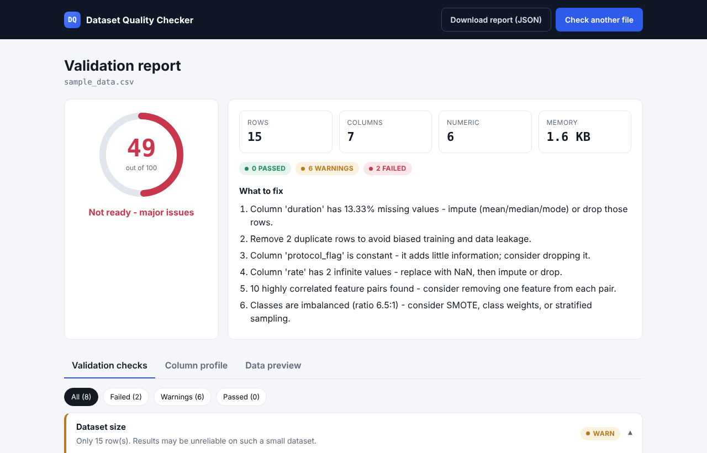
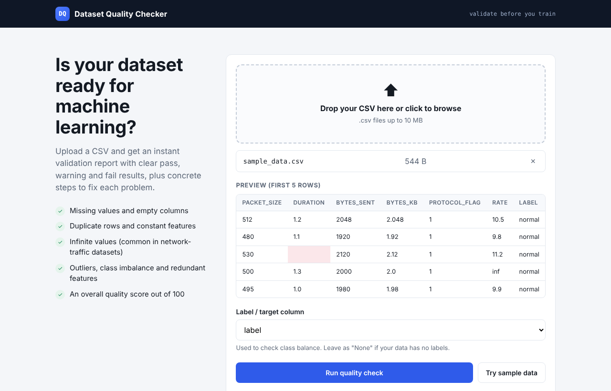

# Dataset Quality Checker

**Validate a CSV dataset before you train a machine-learning model on it.**

Upload a CSV and get an instant validation report: each check is marked pass, warning or fail, the dataset gets an overall quality score out of 100, and every problem comes with a concrete fix.

**Live demo:** https://saabz.pythonanywhere.com/dqc/ (click **Try sample data** to see a report without uploading anything)



---

## Why this tool exists

Data problems are a leading cause of misleading machine-learning results, and this is especially true for intrusion detection. Public network-traffic datasets such as CICIDS2017 are known to contain infinite values, duplicate flows, constant features and severe class imbalance. If these issues are not caught before training, a model can report high accuracy that does not hold up on new data.

This tool makes those checks quick and repeatable, so a dataset can be checked in seconds before any experiment starts. It grew out of my MS thesis work on Zero Trust security for IoT, where intrusion-detection data quality matters directly.

## What it checks

| Check | What it looks for | Why it matters for ML |
|---|---|---|
| **Dataset size** | Fewer than 30 rows | With very few rows, the other checks become unreliable |
| **Missing values** | Empty cells, per column | Most models cannot train on missing values; they must be imputed or removed |
| **Duplicate rows** | Exact copies of earlier rows | Duplicates can land in both training and test sets and inflate accuracy (data leakage) |
| **Constant columns** | Columns with one value, or one value in ≥ 99% of rows | They carry no information and only add noise and cost |
| **Infinite values** | `inf` / `-inf` in numeric columns | Most ML libraries crash on them; common in flow-rate features of network datasets |
| **Outliers** | Values outside 1.5 × IQR, per numeric column | May be errors, or in intrusion data, the actual attacks; flagged for review |
| **Class balance** | Ratio between the largest and smallest class | A model trained on 95% "normal" traffic can score 95% accuracy while missing every attack |
| **Correlated features** | Feature pairs with \|Pearson r\| ≥ 0.95 | Redundant features add little information and can destabilise some models |

### Quality score

The score starts at 100 and loses points for each problem type, with a cap per type so that no single issue dominates:

| Problem | Maximum penalty |
|---|---|
| Missing values | 30 |
| Duplicate rows | 15 |
| Constant columns | 15 |
| Infinite values | 15 |
| Class imbalance (only if a label column is chosen) | 15 |
| Correlated feature pairs | 10 |

**80 or above:** ready for training · **50 to 79:** needs cleaning · **below 50:** major issues.

Outliers and dataset size are shown as warnings but do not reduce the score, because outliers in security data are often genuine attacks rather than errors.

## Features

- Drag-and-drop upload with an instant preview of the first rows, with empty cells highlighted
- Automatic detection of the label column (`label`, `class`, `target`, `attack`, …)
- Validation checklist with pass / warn / fail badges, filters and expandable details
- Column profile with search and sorting: type, missing %, unique values, example values
- Download the full report as JSON
- Handles real-world files: comma, semicolon, tab or pipe separators; UTF-8 or Latin-1 encoding; quoted values; duplicate column names
- Rejects invalid input with clear messages: wrong file type, empty files, binary files renamed to `.csv`, files over 10 MB
- Files are analysed in memory and never stored on the server



## Run it locally

Requires Python 3.11 or newer.

```bash
git clone https://github.com/saabz131395-code/dataset-quality-checker.git
cd dataset-quality-checker
python -m venv venv
venv\Scripts\activate          # Windows
# source venv/bin/activate     # macOS / Linux
pip install -r requirements.txt
python app.py
```

Then open http://127.0.0.1:5000.

The analysis engine also works on its own from the command line and prints the full report as JSON:

```bash
python analyzer.py sample_data.csv label
```

## Project structure

```
dataset-quality-checker/
├── analyzer.py          # All quality checks, the score and recommendations (no web code)
├── app.py               # Flask routes: upload, validation of input, report rendering
├── templates/
│   ├── index.html       # Upload page
│   └── report.html      # Report page
├── static/style.css     # Styles
├── sample_data.csv      # Small dataset with deliberately planted problems
└── requirements.txt
```

The analysis logic in `analyzer.py` is kept separate from the web interface, so the same checks can be reused in a notebook, a script or a training pipeline.

## Testing

The app has a manual test plan of 72 test cases covering upload, preview, report correctness, interaction, layout and 24 edge-case files, including empty files, a 7 MB / 230,000-row file, Urdu column names, Latin-1 encoding, semicolon separators, duplicate column names and HTML/JavaScript injection in column names.

## Known limitations

- **IQR outliers on small or tightly clustered data.** When most values are nearly identical, the interquartile range is tiny and normal values can be flagged. The *Dataset size* warning makes this visible.
- **Correlation uses Pearson's r only**, so it detects linear relationships but not non-linear ones.
- **10 MB upload limit**, set to fit the free hosting tier. Larger datasets can be checked with `analyzer.py` from the command line.
- **CSV only.** Excel, Parquet and JSON are not supported yet.

## Tech stack

Python · Flask · pandas · NumPy · Chart.js · HTML/CSS/JavaScript · hosted on PythonAnywhere

## Author

**Saba Nawaz**, MS Computer Science, University of Management and Technology (UMT), Lahore
Research interests: Zero Trust security for IoT, ML-based intrusion detection, trustworthy AI

Portfolio: https://saabz.pythonanywhere.com · GitHub: [@saabz131395-code](https://github.com/saabz131395-code)
